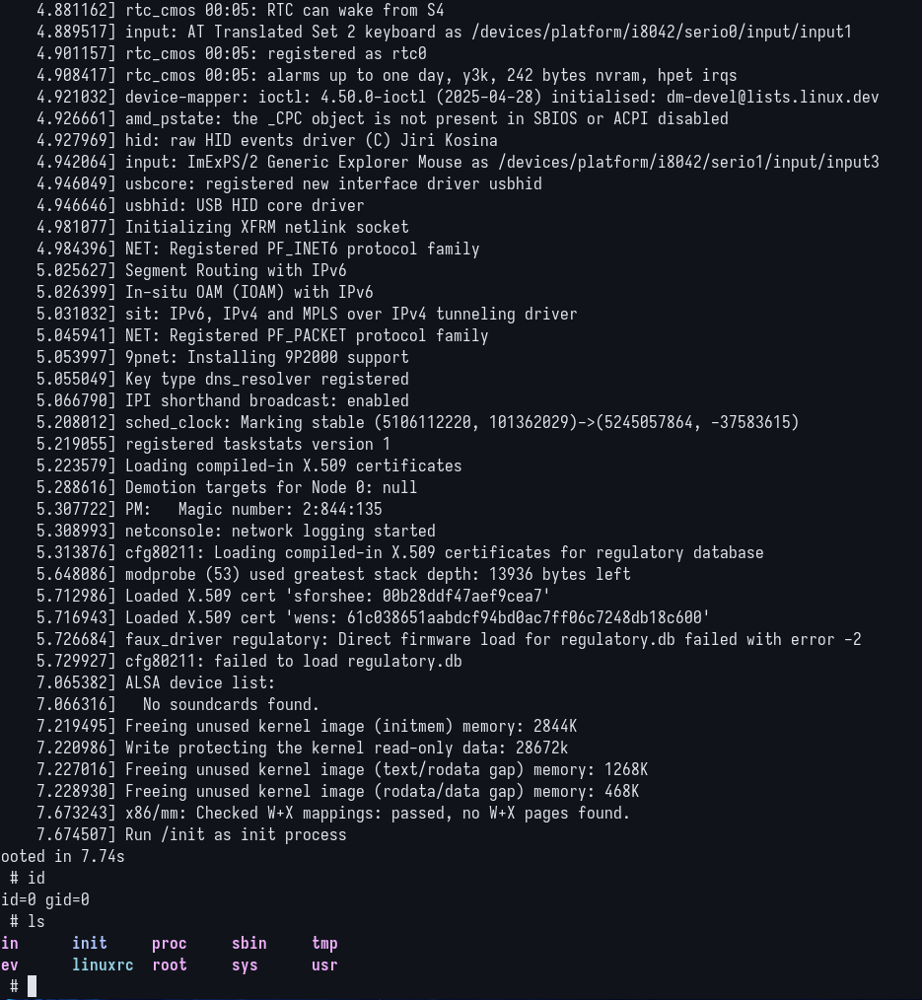

+++
date = '2026-11-10T11:13:46+02:00'
author = "alarmfox"
draft = false
title = '[Part 0] (A)KP: (Advanced) Kernel Programming'
keywords = ["advanced", "kernel", "programming", "os"]
+++

# Introduction
As I got into the PhD program at ReTis Group @Scuola Superiore Sant'Anna in Pisa, I got to choose some graduate courses. Obviously, I chose Advanced Kernel Programming held by L. Abeni.

Here, I will discuss things on exercises and the course just for fun. This will be a series of posts just to not make this one too long (~I may be put everything together if I realize it is compact enough~).

As the course I chose is Advanced Kernel Programming, I found appropriate to integrate from the previous Kernel Programming course.

# First steps: what is an OS and build the Linux kernel

An OS is a set of programs that control hardware providing an abstraction to user-level applications. It does lots of different things: multi-programming, security, hardware management.
Usually, OSes defined the "privileged" component that performs these operations as Kernel.

There are a lot of different kernels. From simplest (such as FreeRTOS) to most advanced (Linux). In this course, we will focus mostly on Linux as it provides:

- Virtual memory (it can also run without MMU if I am not mistaken)
- Multi-programming
- Privilege isolation
- Virtualization (KVM)
- Different scheduling policies

How to build the Linux kernel? Very simple: download the source and run `make`. Well, almost. First, the kernel needs a configuration: we can decide what goes in and what stays out. Second, we need to know `Kbuild`. Thankfully, we can leverage some scripts that provide us with a default configuration for our host.

```sh
# create a default .config file
make defconfig

# optional customize the config
# make menuconfig

# or edit the .config manually and
# issue make olddefconfig to unlock
# the configuration with new options

# build with as much cores we have
make -j`nproc`
```

After some time, the kernel will be in `arch/<our-arch>/boot/bzImage`. I built the kernel, how can I run it? The kernel will just stay there waiting for something to do. We can just build a tiny userspace set of application using Busybox. In the same way as the kernel, it can be configured with `make menuconfig` (it uses Kbuild). I suggest enabling the `CONFIG_STATIC` to have a standlone build and disabling `CONFIG_TC` (this has to do with an issue with recent `gcc` versions. If you need `tc`, you can install an old `gcc` version of use a `Docker` container).

After the build, we need to pack the `initramfs` in a single file, but first we need to create an *init* script in `<busybox-build>/etc/init.d/rcS`. This script will just configure the terminal and the system. You can add a `/bin/sh` at the end or you can add the `::once` line in in the `inittab` file.

```sh
#!/bin/sh

/bin/busybox --install -s

stty raw -echo

chown -R 0:0 /

mkdir -p /proc && mount -t proc none /proc
mkdir -p /sys && mount -t sysfs none /sys
mkdir -p /dev  && mount -t devtmpfs devtmpfs /dev
mkdir -p /tmp  && mount -t tmpfs tmpfs /tmp
mkdir -p /dev/pts && mount -t devpts devpts /dev/pts
```

And invoke it from `<busybox-build>/etc/inittab`:

```sh
::sysinit:/etc/init.d/rcS
::once:/etc/init.d/init
```

`init` script example:

```sh
#!/bin/sh

/bin/sh

sleep 1
poweroff -f
```

Pack everything with:

```sh
find . -print0 | cpio --null -o --format=newc --quiet | gzip -9 >initramfs.gz
```

Finally, we are ready to boot. Use QEMU to emulate a single core 128Mb RAM machine.

```sh
# CTRL A-X to kill
qemu-system-x86_64 -nographic -smp 1 -m 128M -kernel <path-to-bzImage> -initrd <path to initramfs.gz> -append "console=ttyS0"
```

This will put the Linux console in the terminal you are running. If you want a new window open, remove the `-nographic` option and `-append` parameter.

**Yay! It works!**


