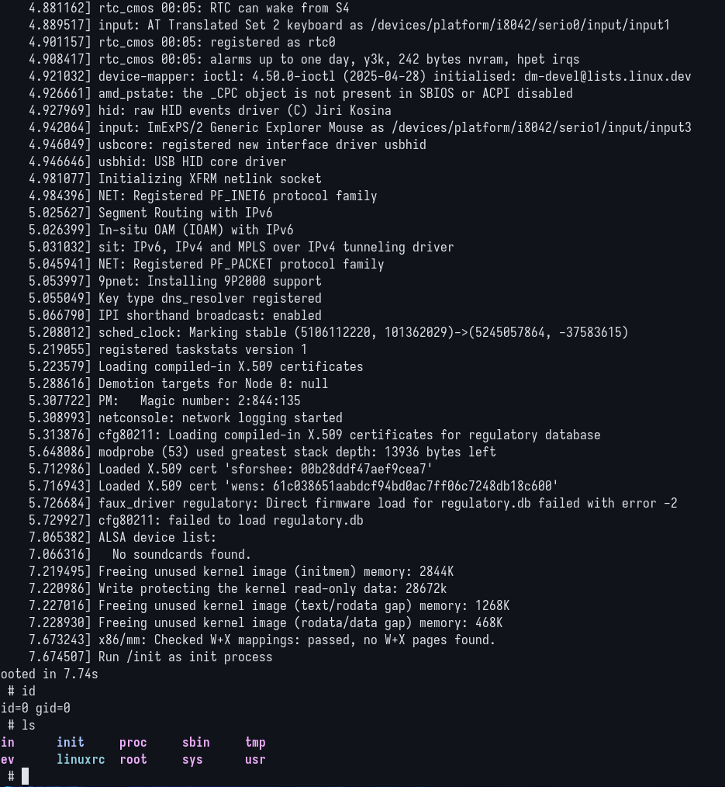

+++
date = '2026-11-10T11:13:46+02:00'
author = "alarmfox"
draft = false
title = '[Part 0] (A)KP: (Advanced) Kernel Programming - Architectural Foundations'
keywords = ["advanced", "kernel", "programming", "os", "computer", "architecture"]
+++

# Introduction
As I got into the PhD program at ReTis Group @Scuola Superiore Sant'Anna in Pisa, I got to choose some graduate courses. Obviously, I chose Advanced Kernel Programming (AKP) and Advanced Operating Systems (AOS) held by L. Abeni.

Here, I will discuss things on exercises just for fun. This will be a series of posts just to not make this one too long (~I may be put everything together if I realize it is compact enough~). It will be an attempt to put all my knowledge of operating systems and computer architecture out.

As I chose AKP and AOS, I found appropriate to integrate from the previous Kernel Programming (KP) course.

First, we are going to setup some architectural foundations and understand how a kernel can exploit them.

# Background

An OS runs on a computer. But, what is a computer?

Let's start from the basics. A computer has a CPU, memory and I/O devices.

The following explanations are not exhaustive, but will be integrated when we need them ~or just to have something to yap about~.

## CPU

Nowadays, we refer to CPU as complex chips that can contains multiple cores. A core is a piece of hardware that can execute programs. Programs are made up of instructions and data.

Each core is powered with a periodic clock. To execute an instruction, the core goes through the following stages:

- **IF** (instruction fetch): retrieves the instruction from memory
- **ID** (instruction decode): processes the instruction and retrieves its operands (if any)
- **EX** (execute): performs the instruction
- **MEM** (memory access): reads or writes memory (if needed)
- **WB** (write back): writes the result to a register (if any)

Each stage uses different hardware. So, while one instruction is being executed, the next can already be decoded and the one after that fetched. This overlap is called a *pipeline*, and it lets a core complete (almost) one instruction per cycle even if each instruction takes five cycles from start to end.

```bob
          cycle:  1     2     3     4     5     6     7     8

 instr 1       +-----+-----+-----+-----+-----+
               | IF  | ID  | EX  | MEM | WB  |
               +-----+-----+-----+-----+-----+

 instr 2             +-----+-----+-----+-----+-----+
                     | IF  | ID  | EX  | MEM | WB  |
                     +-----+-----+-----+-----+-----+

 instr 3                   +-----+-----+-----+-----+-----+
                           | IF  | ID  | EX  | MEM | WB  |
                           +-----+-----+-----+-----+-----+

 instr 4                         +-----+-----+-----+-----+-----+
                                 | IF  | ID  | EX  | MEM | WB  |
                                 +-----+-----+-----+-----+-----+
```


> Seems cool right? Try to think what happens if `instr 2` needs data from `instr 1`. When `instr 2` reaches "EX" phase, `instr 1` has not reached "WB" phase yet. This is called an **hazard**. CPUs have to detect these conditions and solve them to ensure correct execution. There are different kind of hazards depending on assumption we do on the pipeline, which part can overlap with the other etc. We will cover them in another post. This is more than enough now.

CPU cores maintain execution state in registers. One of the most important register is the Program Counter (PC). Usually, a program consists of consecutive instructions (the PC is incremented) and may contain jumps (modify the PC to go to a different part of instruction blocks -> branches).

A CPU has a lot of registers. Some of them are accessible to the programmer, others are internal only. We say that a CPU's instruction set, its programming model and other assumption create the Instruction Set Architecture (ISA). For example, according to the ISA, a bit in the Status Register (SR) may indicate that the last ALU operation result was zero, another bit may indicate the current privilege level, mandate that operations are performed within registers (we cannot perform operation directly from memory, we need just to load things inside the CPU), or specify the memory model (which we might dive into a dedicated post).

Usually, we refer to instructions as "instruction mix" as we don't care from where they are coming from. For example, they can come from two different programs.

To improve throughput (measured as instructions completed per clock cycle), engineers introduced hardware multi-threading. To see the idea, look at what a core really contains. After the instructions are fetched and decoded, they are sent to different *execution units* that work in parallel: the Arithmetic Logical Unit (ALU) does the sums and logic operations, the divider does divisions, the load/store unit talks to memory.

```bob
   Thread A                  Thread B
 +-----------+             +-----------+
 | PC | regs |             | PC | regs |      duplicated
 +-----+-----+             +-----+-----+
       |                         |
       +------------+------------+
                    |
                    v
          +--------------------+
          |   Fetch   Decode   |               shared
          +--------------------+
                    |
        +-----------+-----------+
        |           |           |
        v           v           v
  +-----------+ +---------+ +------------+
  |    ALU    | | DIVIDER | | Load Store |     shared,
  | add, and  | | div     | |    unit    |     in parallel
  +-----------+ +---------+ +------------+
        |           |           |
        +-----------+-----------+
                    |
                    v
          +--------------------+
          |     Write back     |
          +--------------------+
```

A single instruction rarely keeps all these units busy: a division, for example, does not touch the hardware that does the sums, and it takes many cycles. With a sufficiently varied instruction mix, a single core can "theoretically" execute instructions from two threads at the same time (one using the divider while the other  uses the ALU), by duplicating only a minimal amount of hardware. For example, putting two PCs and two sets of registers in a single core, as in the figure, is one such duplication. Everything else is shared.

>This is the so-called _hyper-threading_, and is the reason they sell PCs saying 2 Core / 4 Threads.

The cycle is not always straight. For example, an external peripheral receive some data and `raises an interrupt`. The `interrupt` makes the PC to go to a specific instruction where the *Interrupt Service Routine* (ISR) code is.

Interrupts can also come from within the CPU itself. For example, a division by zero cannot be completed, so the CPU raises an error and jumps to a handler. In that case, we refer to them as *exceptions*.

Programs can also trigger an exception on purpose, using a special instruction, to ask for a specific service. This is how an OS offers its services to applications: the program raises the exception, the CPU switches to the higher-privileged kernel's handler (piece of code that _handles_ the event), and the kernel does the work on its behalf.

## Memory

There are many kinds of memory. When we refer to memory, we mean main memory: volatile storage connected to the CPU through a memory controller. Most computers use DRAM through a DDR interface.

Memory is a long sequence of bytes, and each byte has an address. Using different instructions, the CPU can access memory as a *byte*, *half-word*, *word*, *double word* etc. A byte is always 8 bits (_of course_), but the size of a word depends on the architecture: it is 32 bits on RISC-V and 16 bits on x86 (for historical reasons). Most modern general-purpose CPUs are 64-bit, meaning that their registers and addresses are 64 bits wide. Old 8-bit processors have 8-bit registers (and usually 16-bit addresses).

Memory addresses are numbers: the number you specify selects a specific location in memory. We usually write them in hexadecimal because one hex digit is exactly 4 bits, which makes them compact and easy to convert to binary.

Here is a made-up memory with 32-bit (4-byte) words, so consecutive words are 4 addresses apart. `0x10xx` contains data, `0xF0xx` contains instructions.

```
0x1000 -> |42|
0x1004 -> |43|
0x1008 -> |00|
...
0xF000 -> | instruction 1 |
0xF004 -> | instruction 2 |
0xF008 -> | instruction 3 |
0xF00C -> | instruction 4 |
```

The instructions could look like the following:

```
# this is some kind of CPU language (pseudo-assembler)
# that does not exist, but is pretty close to reality

# put the content of address 0x1000 in register a0
0xF000 => load.word a0, [0x1000]
# put the content of address 0x1004 in register a1
0xF004 => load.word a1, [0x1004]
# add a1 and a0 and put result in a2
0xF008 => add a2, a1, a0
# store the result in a2 to address 0x1008
0xF00C => store.word [0x1008], a2
```

The PC starts at `0xF000` and, after each instruction, is incremented by 4 (the size of an instruction) to point to the next one, unless a jump changes it.

This is pretty much it for now, but memory is a very complicated beast. We refer to the memory above as ***physical** memory*. We have just **ONE** physical memory, so each application should use its own part of it, without conflicting with other programs.

Imagine you cannot open Firefox because a Dark Souls instance is already running and the two use the same addresses. Obviously, this is not true in reality (although on simple or old systems it really works like this). This is why we have ***virtual** memory*.

With virtual memory, each program has its own *address space*: it sees a private range of "virtual" addresses, and two programs can use the same virtual address without interfering with each other. The CPU has a Memory Management Unit (MMU), a piece of hardware between the core and the memory that translates virtual addresses to physical addresses. For each program, the OS describes the translation (memory is split in fixed-size *pages*, and the translation is stored in *page tables*) and the MMU applies it on every access. The translation also carries permissions (read, write, execute, user or kernel), so the OS can protect memory. If a program touches an address without a valid translation or without the right permissions, the MMU raises an exception called *page fault* and the kernel takes over.

This technique is called *paging*: virtual memory is divided into fixed-size blocks (typically 4 KiB) called *pages*, physical memory into blocks of the same size called *frames*, and the page table maps each page to a frame. A virtual address is split in a page number, which is translated, and an offset inside the page, which stays unchanged; so any page can be mapped to any free frame, and the memory of a program does not need to be contiguous in physical memory.

```bob
   Firefox                     Physical memory              Dark Souls
 virtual addresses                                       virtual addresses

  +--------+                  +--------------+
  | 0x0000 |----------------->| frame 0x1000 |
  +--------+                  +--------------+                +--------+
                              | frame 0x2000 |<---------------| 0x0000 |
  +--------+                  +--------------+                +--------+
  | 0x1000 |----------------->| frame 0x3000 |
  +--------+                  +--------------+                +--------+
                              | frame 0x4000 |<---------------| 0x1000 |
  +--------+                  +--------------+                +--------+
  | 0x2000 |----------------->| frame 0x5000 |
  +--------+                  +--------------+                +--------+
                              | frame 0x6000 |<---------------| 0x2000 |
                              +--------------+                +--------+

  Same virtual addresses, different frames: each page table decides.
```

To improve performance, translation can be saved in special buffers called Translation Lookaside Buffer (TLB).

### Caches

We have one memory and many cores (and not only cores today) accessing it. The main problem is latency: a DRAM access takes about 100 ns, while a core executes an instruction in a fraction of a nanosecond. This is why we add small, fast memories near the cores, called caches.

A cache keeps copies of recently used blocks of memory (*cache lines*, typically 64 bytes). It works like a key-value store: the key is computed from the address (an index and a *tag*) and the value is the data in the line. If the key is found (a *hit*), the data comes back in a few cycles; otherwise (a *miss*) it is fetched from memory. This works because programs show *locality*: they reuse the same data (temporal locality) and use data close to what they just used (spatial locality). Caches are small because fast memory (SRAM) is expensive and gets slower as it grows.

Normally, cores talk to the cache and not directly to the memory (device registers, for example, are not cached).
We have 2 kinds of cache:

- Instruction cache (I-cache)
- Data cache (D-cache)

They are separate because the pipeline needs both at the same time: in the same cycle, one instruction is being fetched (IF, from the I-cache) while another is reading or writing data (MEM, through the D-cache). Separate caches avoid this conflict and can be optimized for different access patterns (instructions are read-only and mostly sequential). Usually, the split exists only at the first level (L1); the larger L2 and L3 caches hold both instructions and data.

L1 caches are per core, we can theoretically have `n-1` cache level shared between different cores. For example, in a 16 core architecture, we could have `16` L1 caches (one per core) and `4` L2 caches (one every 4 cores) and an L3 (shared among all the cores). The goal is to mitigate cost and conflicts.

We usually refer to the `n-th` level as the Last Level Cache (LLC) since it is the component that talks directly with the memory controller.

> Problem: how does a cache know that a block is stale and it needs to be refreshed from memory?
> Answer: maybe in another post

### Caches and virtual addresses

Do caches use virtual or physical addresses? It depends on the level. The load/store unit always starts with a virtual address, so the MMU (and its TLB) has to be involved somewhere.

```bob
                  +------------------+
                  |    Load Store    |
                  |      unit        |
                  +--------+---------+
                           |
                    virtual address
              +------------+-------------+
              |                          |
         page number               low bits: offset
              |                          |
              v                          v
        +-----------+             +--------------+
        |    TLB    |             | L1 D cache   |
        |    MMU    |             | picks a line |
        +-----+-----+             +------+-------+
              |                          |
       physical page              tag of that line
              |                          |
              +------------+-------------+
                           |
                           v
                  +------------------+
                  |    tag equal?    |
                  +--+------------+--+
                     |            |
                    hit          miss
                     |            |
                     v            v
                   data      L2, L3, DRAM

     TLB miss: the MMU walks the page tables in memory
```

The L1 cache is usually *virtually indexed, physically tagged* (VIPT). The low bits of an address (the offset inside a page, 12 bits for 4 KiB pages) are the same in the virtual and in the physical address, so the cache can use them to select a cache line while the TLB translates the page number in parallel. The translated (physical) address is then compared with the tag stored with that line. This hides the translation latency. The price is a constraint: the index and the line offset must fit in the page offset (for example, 6 bits to choose among 64 lines and 6 bits for the byte inside a 64-byte line use exactly 12 bits), which limits how the L1 cache can be organized.

L2 and L3 are usually *physically indexed, physically tagged* (PIPT): the address is already translated by the time they are accessed. Fully virtual caches (VIVT) exist but are rare: two programs can use the same virtual address for different data, so they need to be flushed (or tagged) at every context switch, and the same physical memory can appear under different virtual addresses (aliasing). The instruction side works the same way, with its own TLB for instruction fetches.

## I/O devices

There are different ways to access devices. The most common one is *memory mapped I/O* (MMIO). The architecture (aka the CPU) specifies that some physical addresses are not used to access the main memory, but are "wired" to peripherals. Most peripherals have registers, and we use them by reading and writing at those addresses (using plain `load` and `store` operations).

This works because the CPU just sees a flat *physical* address space. Its size is decided by the implementation (for example 48 to 52 bits on current 64-bit CPUs, not the full 2^64 bytes). Some regions of this space are RAM, others are devices. Usually, special devices (such as the interrupt controller, which routes the interrupts of the devices to the cores: APIC on x86, GIC on ARM, PLIC on RISC-V) live at well known addresses. Programs never see these addresses directly: the kernel maps them into its virtual address space. The following figure shows the physical address space of a typical x86 PC, together with the legacy I/O port space (more on that below).

```bob
             Physical address space                     IO port space
                  of an x86 PC                         legacy, x86 only

            +------------------------------+       +---------------------------+
            |  RAM above 4 GiB             |       |  0x0000 to 0xFFFF         |
 4 GiB      +------------------------------+       |                           |
            |  Firmware flash              |       |  Not part of the memory   |
 0xFF000000 +------------------------------+       |  map: accessed only with  |
            |  Local APIC registers        |       |  the in and out           |
 0xFEE00000 +------------------------------+       |  instructions             |
            |  IO APIC registers           |       |                           |
 0xFEC00000 +------------------------------+       |  0x3F8  serial port       |
            |  PCI devices: the BARs map   |       |  0x60   keyboard          |
            |  their registers here        |       |  0xCF8  PCI config        |
 0xC0000000 +------------------------------+       +---------------------------+
            |  RAM below 4 GiB             |
            |                              |
 0x0        +------------------------------+
```

Most devices today sit on a bus like Peripheral Component Interconnect (PCI) or PCI-Express. Every device exposes up to 8 *functions*, and each function has a small configuration space with a few *Base Address Registers* (BARs). At boot, the firmware or the OS scans the bus, picks a free range inside the "PCI hole" (its exact position varies) for every BAR and writes it there. From that moment, the registers of the device appear at that range in the physical address space. On embedded systems (ARM, RISC-V) devices are usually at fixed addresses described by a Device Tree, while x86 uses Advanced Configuration and Power Interface (ACPI) tables.

### Registers are not memory

Device registers cannot be treated like memory, because accessing them has side effects. Reading a status register can clear an interrupt flag, reading a FIFO register removes a byte from the device, and writing `0` to an enable register disables the peripheral. If these accesses went through the cache, the CPU could read a stale value, delay a write  or merge two writes into one, and a read could even be repeated. So these accesses must reach the device, one by one and in order.

Remember the memory section: the cache is not part of the program, it is a property of the *memory type* of the page. The kernel maps device registers as uncached (on x86 through the page tables, PAT, and the MTRRs) or as "device memory" (ARM), or through memory attributes (RISC-V). For the other half of the problem, the compiler, C has the `volatile` keyword. It does not touch the cache or the hardware: it only tells the compiler that every access is important, so it cannot remove, merge or reorder it.

```c
// status register of a made-up device, already mapped by the kernel
volatile uint32_t *status = (volatile uint32_t *)DEVICE_BASE;

// without volatile, the compiler could read it once and loop forever
while ((*status & READY) == 0)
    ;
```

### Port Mapped I/O

Another way to access devices is Port Mapped I/O (PMIO). The CPU has a separate address space (on x86, 64 KiB of *I/O ports*) that is not part of the memory map, and it provides specific instructions to access it (`in` and `out`). Its only advantage is that it does not consume address space, which mattered on 32-bit systems. The downsides are the special instructions (from C you need inline assembly or intrinsics) and that it is a world apart from the normal memory mechanisms.

This is a legacy mechanism. It exists only on x86: newer architectures such as ARM and RISC-V do not have it, and everything is MMIO. Modern x86 CPUs still implement it, but only for backward compatibility with old devices (the serial port, the PS/2 keyboard, the first PCI configuration mechanism). New devices use MMIO.

### Accessing I/O data

We usually send or receive data from an I/O device, and we need to know when it is ready. Imagine we are waiting for data from a device. We have two options. With *polling*, the kernel continuously checks a status register, as in the snippet above: it is simple and has low latency, but the CPU is busy doing nothing. With *interrupts*, we program the peripheral to raise an interrupt when it has finished: in the meantime the CPU can do other work (or the waiting task can sleep), and the ISR takes over when the data arrives.

What happens when we are waiting for a lot of data that is sent in chunks? We interrupt the CPU for every chunk, and the cost of each interrupt (saving the state, running the handler, polluting the caches) adds up. For this reason, another mechanism was introduced: Direct Memory Access (DMA). A device with DMA can read and write the memory by itself, without the CPU (on PCIe it is usually a capability of the device; older systems had a separate DMA controller). The CPU programs it to act on its behalf. For example, one can say: this device will write 100 times 1024 bytes to the memory. When it finishes, interrupt me.

DMA brings two problems. The first one is about addresses. The device does not know the CPU page tables: it uses *physical* addresses (also called bus addresses). So the kernel must give it the physical address of the buffer, the buffer must stay where it is (it cannot be swapped out or moved), and it must be contiguous in physical memory (or described as a list of chunks, called scatter gather). A buggy or malicious device can write anywhere in memory. The *IOMMU* solves these issues. It is the MMU of the devices: it sits between the devices and the memory and translates the addresses that a device uses into physical addresses, using page tables set by the OS. So the device can only reach the pages the kernel allows, and a buffer scattered in physical memory can look contiguous to it. It is also what allows to give a device to a virtual machine safely.

The second problem is about caches. The device writes the memory directly, without passing through the CPU cache. The cache can hold an old copy of the data (so the CPU reads stale values after the device wrote), or a dirty line that is written back later and overwrites the data of the device. On x86 the hardware keeps DMA coherent with the caches. On many ARM and RISC-V systems it does not, so the kernel must write back the cache before the device reads a buffer, invalidate it before the CPU reads what the device wrote, or map the buffer as uncached.

# First steps: what is an OS

So, what is an OS? Roughly, it is a set of programs that look after the hardware and give user applications a friendlier view of it. It does lots of different things: memory management, task management, security, and the ability to run many things at once (*multitasking*).

The heart of it is the *kernel*: the "privileged" component that does all the dirty work, running at the highest privilege level we met earlier. We say that things running in the kernel are _kernel-space_. Everything else (the shell, libc, init, your favourite tools) lives in user-space, around it. We will build a tiny user-space ourselves in a moment.

There are a lot of different kernels. FreeRTOS is tiny: basically a scheduler for microcontrollers, where all tasks share the same address space. Linux is *monolithic*: scheduler, memory management and drivers all live together in the privileged part. Microkernels (such as seL4 or Minix) go the opposite way and keep as little as possible in there.

One of the most important jobs of a kernel is scheduling. What does scheduling mean?

*Scheduling* means deciding which task runs on which CPU core, and for how long. This is the *policy*. The *mechanism* that makes it happen is the context switch: saving the state of the previously running task so that it can resume later, and loading the state of the next one. What is the "state" of a program? We can define such state (or execution context) as the minimal amount of information to make the program resume its execution correctly. We can represent the state as the value of all CPU registers (containing code and data). Usually, kernels just save the state by putting it in memory.

> We refer to task as a generic term to indicate a block of code that runs. We avoid using process or threads because different OS can implement them differently. (Linux itself is not picky: both are a `task_struct`.)

But there is a catch. If a task is running on the core, how does the kernel get the CPU back to schedule something else? Remember interrupts? A timer raises one periodically, the CPU jumps into the kernel, and the kernel can choose another task. This is called *preemption*. Tasks can also call the kernel on purpose, using the exceptions we saw before, to ask for its services.

According to which *policy* does the kernel choose among the available tasks? Does it need to guarantee timings (the anti-lock braking system of a self-driving car), ensure low-latency audio/video streaming, or low-power consumption?

In this course, we will focus mostly on Linux as it provides:

- Virtual memory (there is even a no-MMU flavour, uClinux, for small chips)
- Multitasking
- Privilege isolation
- Virtualization (KVM)
- Different scheduling policies (the fair one, the real-time ones such as `SCHED_FIFO`, and `SCHED_DEADLINE`)

In the next posts, we will explore different parts of a kernel.

# Build the Linux kernel

How to build the Linux kernel? Very simple: download the sources and run `make`. Well, almost.

We will need the usual tools: a C toolchain, `make`, `flex`, `bison`, `bc` and the development headers of `libelf`, OpenSSL and ncurses (the last one is for `menuconfig`).

First, the kernel needs a configuration: we can decide what goes in and what stays out. The kernel build system (`Kbuild`, with `Kconfig` describing the options) keeps it in a `.config` file. Thankfully, we can leverage some scripts that provide us with a default configuration for our architecture.

```sh
# create a default .config file for our architecture
make defconfig

# optionally customize the config
# make menuconfig

# or edit the .config manually and issue make olddefconfig
# to update it (new options get their default value)

# build with as many cores as we have
make -j`nproc`
```

After some time, the kernel will be in `arch/<our-arch>/boot/bzImage` (`arch/x86/boot/bzImage` on x86). I built the kernel, so how can I run it? If we boot it right now, it will start, initialize the hardware and then panic. The last thing a kernel does at boot is to start the first user-space process (PID 1, usually called `init`), and we do not have one yet. Remember the OS intro? A kernel alone is not an OS: we need a user-space.

We can build a tiny user-space set of applications using BusyBox: a single executable that implements lots of the usual commands (`sh`, `ls`, `mount`, even `init`). In the same way as the kernel, it can be configured with `make menuconfig` (it uses Kconfig). I suggest enabling `CONFIG_STATIC` to have a standalone build: our user-space will live in a tiny filesystem with no libc inside, so a static binary has everything it needs. I also suggest disabling `CONFIG_TC`: the `tc` applet did not build for me. I don't know for sure, but I suspect it is because CBQ was removed from the kernel headers in 6.8.

Then run `make` and `make install`. BusyBox puts the result in the `_install` directory (this is our `<busybox-build>` from now on), full of symlinks to the `busybox` binary.

Now we need to pack everything in an `initramfs`: a compressed `cpio` archive that the kernel unpacks into a RAM filesystem and mounts as `/`, so no disk is needed. But first we have to tell our user-space what to do at boot. This is how it goes: the kernel starts `/sbin/init` (it looks for `/init` first, then falls back to this one, which is BusyBox's `init`). It reads `/etc/inittab`, runs a boot script once (`sysinit`), and then runs our `init` script.

Let's create the boot script in `<busybox-build>/etc/init.d/rcS`. It will just configure the terminal and the system.

```sh
#!/bin/sh

stty raw -echo

mkdir -p /proc && mount -t proc none /proc
mkdir -p /sys && mount -t sysfs none /sys
mkdir -p /dev  && mount -t devtmpfs devtmpfs /dev
mkdir -p /tmp  && mount -t tmpfs tmpfs /tmp
mkdir -p /dev/pts && mount -t devpts devpts /dev/pts
```

And invoke it from `<busybox-build>/etc/inittab`:

```sh
::sysinit:/etc/init.d/rcS
::once:/etc/init.d/init
```

`init` script example (`<busybox-build>/etc/init.d/init`):

```sh
#!/bin/sh

/bin/sh

sleep 1
poweroff -f
```

PID 1 must never exit, or the kernel panics. So when we quit the shell, we power the machine off ourselves. (You could skip the `::once` line and put `/bin/sh` at the end of `rcS`, but then we would not get a clean power off.)

Both scripts must be executable, or the boot will fail:

```sh
chmod +x etc/init.d/rcS etc/init.d/init
```

The final layout looks like this:

```
<busybox-build>/
    bin/ sbin/ usr/ linuxrc     (installed by BusyBox)
    etc/
        inittab
        init.d/
            rcS
            init
```

Pack everything with (`-R 0:0` makes all files owned by root, whoever built them):

```sh
find . -print0 | cpio --null -o --format=newc --quiet -R 0:0 | gzip -9 >initramfs.gz
```

Finally, we are ready to boot. Use QEMU to emulate a single core machine with 128 MB of RAM.

```sh
# press Ctrl-A, then X to quit
qemu-system-x86_64 -nographic -smp 1 -m 128M -kernel <path-to-bzImage> -initrd <path-to-initramfs.gz> -append "console=ttyS0"
```

This will put the Linux console in the terminal you are running (`console=ttyS0` sends it to the serial port, which `-nographic` connects to your terminal). If you want a new window open, remove the `-nographic` option and the `-append` parameter.

**Yay! It works!**



We compiled the Linux kernel and ran it on an emulated PC, with a user-space of our own.
